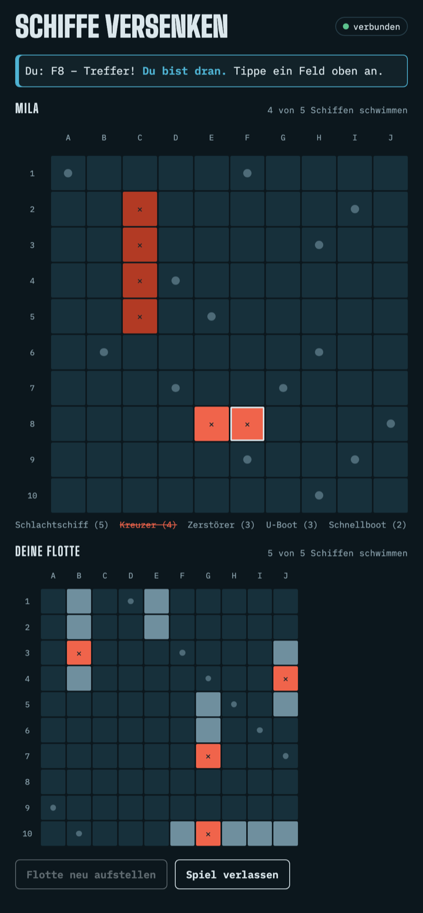

# Schiffe versenken

Das klassische Schiffe versenken für zwei Handys – direkt im Browser, ohne App, ohne Anmeldung und ohne eigenen Server. Die beiden Geräte verbinden sich per WebRTC direkt miteinander.

**Spielen:** [raoulus.github.io/schiffe](https://raoulus.github.io/schiffe/)

<p align="center">
  
</p>

## So geht's

1. Beide öffnen die Seite auf ihrem Handy (am besten im selben WLAN).
2. Ein Spieler tippt auf **Spiel erstellen** und bekommt einen Code mit vier Buchstaben.
3. Der andere gibt den Code unter **Beitreten** ein.
4. Wer dran ist, tippt ein Feld im gegnerischen Gewässer an. Bei einem Treffer darf man nochmal.
5. Wer zuerst alle fünf gegnerischen Schiffe versenkt, gewinnt. Danach gibt es auf Wunsch eine **Revanche**.

## Funktionen

- **Flotte:** Schlachtschiff (5), Kreuzer (4), Zerstörer (3), U-Boot (3), Schnellboot (2) – zufällig aufgestellt, Schiffe berühren sich nicht. Vor dem ersten Schuss lässt sich die Flotte neu würfeln.
- **Fair:** Die eigene Flotte verlässt nie das Handy. Der Gegner erfährt nur, ob ein Schuss trifft – erst am Spielende wird die Aufstellung aufgedeckt.
- **Robust:** Der Spielstand liegt im `localStorage`. Nach Neuladen, Bildschirmsperre oder Verbindungsabbruch verbindet sich das Spiel automatisch neu und macht dort weiter, wo es war.
- **Hell und dunkel:** passt sich dem Farbschema des Geräts an.

## Technik

Alles steckt in einer einzigen Datei, [`index.html`](index.html) – HTML, CSS und JavaScript ohne Build-Schritt. Für den Verbindungsaufbau wird [PeerJS](https://peerjs.com/) von unpkg geladen; dessen öffentlicher Vermittlungsserver bringt die beiden Handys nur zusammen, die Spielzüge laufen danach direkt zwischen den Geräten.

## Lokal starten

Die Seite muss über HTTP ausgeliefert werden, z. B.:

```sh
python3 -m http.server 8000
```

Dann `http://localhost:8000` öffnen. Zum Testen reichen zwei Browserfenster – allerdings teilen sie sich den `localStorage`, deshalb am besten ein normales und ein privates Fenster verwenden.
